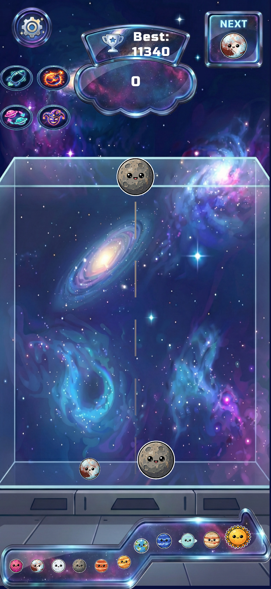
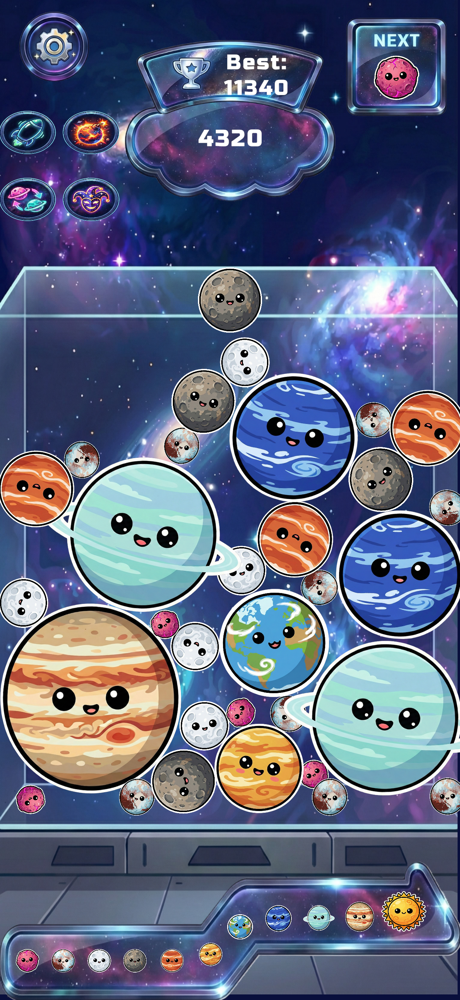
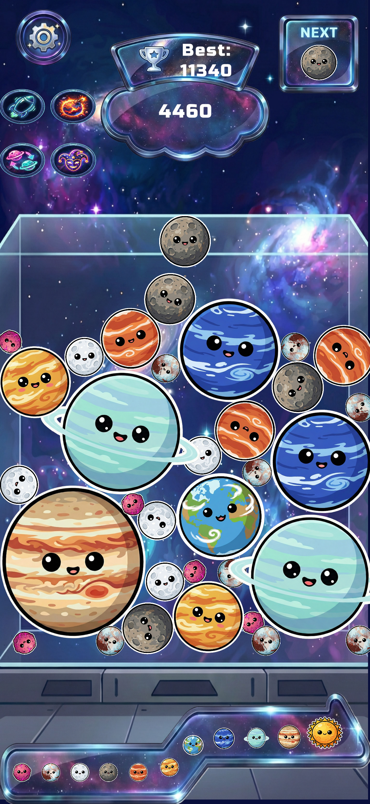
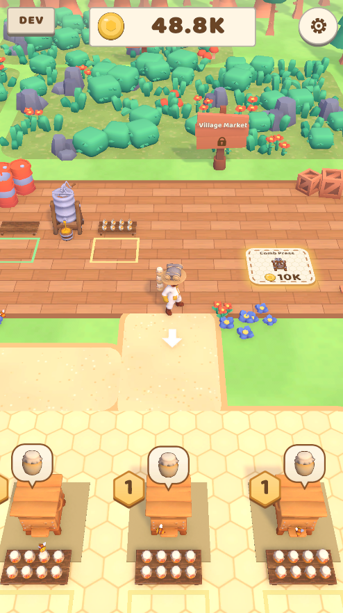
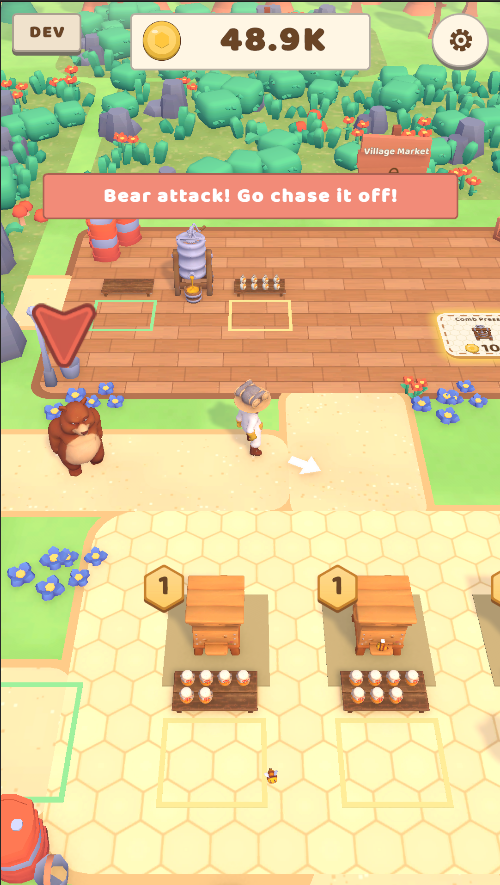
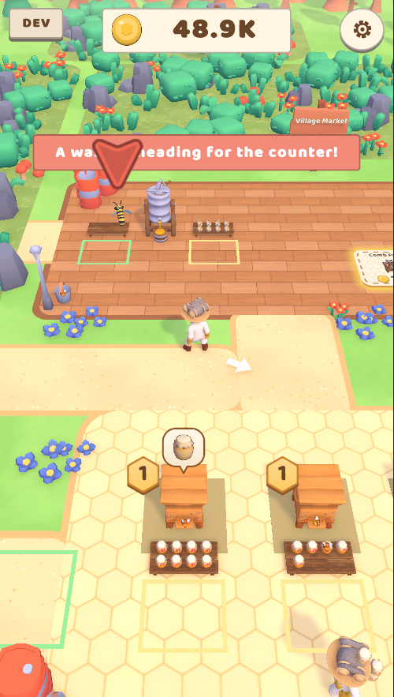

  

  
  
  
  

## 👋 About me

- 🎓 4th-year **Digital Game Design** student at Nişantaşı University, Istanbul
- 🎮 I design and build games in **Unity**, mostly for mobile
- 📱 My first game, **Planet Merge Puzzle**, is live on the App Store
- 🐝 Currently building **BeeMaster**, a 3D idle-arcade game, solo
- 🌲 Also working on a first-person folk horror game with a team of four
- 📚 Leveling up my C# and Unity fundamentals every week
- 🐍 Outside games, I write Python: trading bots and automation tools
- 🎯 Looking for a **game design / Unity development internship**

## 🎮 Games

  <h3>🪐 Planet Merge Puzzle</h3>
  

    A space-themed merge puzzle for iOS. Drop planets into orbit, merge identical ones into bigger worlds
    and work your way up to the sun before the orbit overflows.
  

  

    
    
    
    
  

  

    
    &nbsp;
    
    &nbsp;
    
  

  

 

  <h3>🐝 BeeMaster</h3>
  

    A 3D idle-arcade bee farm game for mobile. Collect honey, carry and sell the jars, hire workers to grow your farm
    and chase off the bears and wasps that come for your honey.
  

  

    
    
    
    
  

  

    
    &nbsp;
    
    &nbsp;
    
  

  

## 🛠 Tools

  
  
  
  
  
  

---

  📫 Open to internship opportunities. Reach me on <a href="https://www.linkedin.com/in/yavuz-adal%C4%B1-a4789231b">LinkedIn</a> or at <a href="mailto:yavuz.adali36@gmail.com">yavuz.adali36@gmail.com</a>

